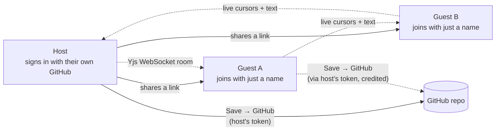

# Unified Spec Workspace

GitHub-native collaboration layer for turning product intent into an agreed, build-ready change — without forcing every initiative through the same SDD ceremony.

**Product thesis (v0.1):** GitHub remains the durable system of record. This app is an accessible, **live collaborative** interface for Product, Design, Engineering, Analytics, BA and Delivery. One host runs the workspace and connects GitHub; everyone else joins a shared link and edits together in real time; saves become commits.

Visual tokens are local CSS variables — see `docs/style.md`.

## The collaboration model




1. **One person hosts.** They run the app (`npm run host` / Docker) and sign in with their own GitHub account at `/login`. Their token is cached for the life of the process — it's what actually pushes every commit, including guests'.
2. **They share the link** shown in the banner at the top of the app once they're signed in (LAN IP or tunnel URL, depending on how it's reached).
3. **Everyone else joins with just a name** — no GitHub account needed. They see the host (or "no host connected yet") on `/login`.
4. **Everyone edits the same artefact at once.** Each tab (Context, Requirements, …) is a shared [Yjs](https://docs.yjs.dev/) document over a WebSocket room. You see each other's cursors move in real time, like Figma/Google Docs — not turn-based locking.
5. **Saves are explicit commits.** ⌘/Ctrl+S (or the Save button) pushes the current text to GitHub. Guest saves are committed with the guest's name as commit `author` (GitHub shows it on the commit, even though the host's token performed the push) and the commit message flags `(guest, via host)`.

This keeps the PRD's principle intact: **GitHub is the root of truth, humans own the decision to commit** — live co-editing happens in between explicit saves, it doesn't silently rewrite history.

## What this MVP includes

| Capability | Status |
| --- | --- |
| Host-run web workspace | Yes |
| Host connects GitHub once; guests join by name only | Yes |
| **Live multi-cursor co-editing** (Yjs CRDT + CodeMirror) | Yes |
| Commit attribution for guest edits (author + message) | Yes |
| Initiatives with Quick / Standard / Deep modes | Yes |
| Artefact tabs (Context → Traceability by mode) | Yes |
| Save → GitHub commit (or local `.data/` for demos) | Yes |
| Adaptive mode recommendation (Stage 0) | Yes |
| Shared visual tokens | Yes (`docs/style.md`) |
| Initiative change branches + PR checks | Deferred |
| AI drafting / gap analysis | Deferred |
| Jira export | Deferred |

## Host setup

> **Note:** this app runs a **custom Node server** (`server.mjs`), not plain `next dev`/`next start` — it needs to own the raw WebSocket upgrade for live collaboration alongside the Next.js app. Always start it via `npm run dev` / `npm run host` / `npm start`, not the Next CLI directly.

### 1. Local demo (no GitHub yet)

```bash
cp .env.example .env.local
# AUTH_SECRET is required — generate: openssl rand -base64 32
# STORAGE_MODE=local

npm install
npm run host
```

Open `http://localhost:3000` → **I'm hosting** section won't work without `AUTH_GITHUB_ID`/`SECRET` yet, so instead use **I was sent a link** to join as a named guest against local disk storage. Create an initiative, edit an artefact, hit Save — files land under `.data/initiatives/`.

Share your LAN URL (`http://<your-ip>:3000`) so others on the same network can join and co-edit live immediately.

### 2. GitHub as single source of truth (the real flow)

1. Create (or choose) a **specs** repository, e.g. `your-org/product-specs`.
2. Create a GitHub **OAuth App** (Settings → Developer settings → OAuth Apps):
   - Homepage: `http://localhost:3000` (or your host's reachable URL)
   - Callback: `http://<host>/api/auth/callback/github`
3. Put values in `.env.local`:

```bash
STORAGE_MODE=github
AUTH_GITHUB_ID=...
AUTH_GITHUB_SECRET=...
GITHUB_SPECS_OWNER=your-org
GITHUB_SPECS_REPO=product-specs
GITHUB_SPECS_BRANCH=main
AUTH_URL=http://localhost:3000
AUTH_SECRET=...
```

4. Restart `npm run host`. Go to `/login` → **I'm hosting** → **Continue with GitHub**. You're now the host — a banner shows your shareable link.
5. Send that link to teammates. They open it → **I was sent a link** → enter a name → they're in, editing live, no GitHub account needed.

### Repo layout (canonical, in your specs repo)

```
initiatives/
  <slug>/
    initiative.yaml
    context.md
    requirements.md
    design.md              # standard+
    technical-plan.md      # standard+
    tasks.md
    decisions.md           # standard+
    reviews.md             # standard+
    traceability.md        # deep
```

## Docker host

```bash
docker compose up --build
```

Exposes port `3000`. Pass env vars via `.env.local` (mounted by `docker-compose.yml`) or compose `environment`.

## Architecture (MVP)

```
Browser (host + guests) ──ws──► server.mjs ──► Yjs room (in-memory, per artefact)
                          ──http─►            ├─► Next.js app (auth, pages, API)
                                               └─► GitHub Contents API (on explicit Save)
```

- **Yjs rooms** live in the host process's memory, keyed by `<slug>__<kind>`. They hold the live, uncommitted editing state shared across everyone currently in that tab. Restarting the host clears live (unsaved) collaboration state — committed content is unaffected, it's already in GitHub.
- **Host session** (`src/lib/host-session.ts`) is also in-memory, single-process — intentional for a tool one person runs per instance, not a multi-tenant service.
- Platform DB is intentionally absent — only sessions (JWT cookies) and the two in-memory singletons above.

## Next slices (from PRD)

1. `initiative/<slug>` branches + PR-based artefact review
2. Async review prompts + dispositions
3. Change/diff view (current vs proposed behaviour)
4. AI explore / gap analysis with evidence links
5. Jira export + implementation PR links
6. Persist Yjs room state (currently memory-only; a mid-session host restart loses unsaved live edits, not committed ones)

## Open product decisions (PRD §13)

Still unsettled: initiative vs change as canonical unit, guest access beyond name-only join, default repo structure, AI provider approval, minimum Product/Design/Engineering approval set.
