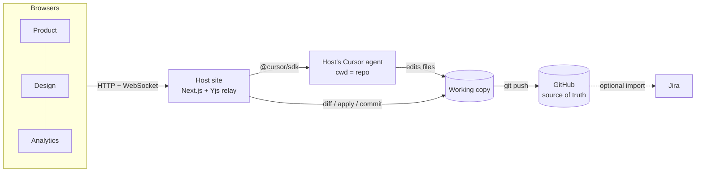

# How it works — and how to make it real

This doc is for the engineers who'd take this from prototype to product. Read [framework.md](framework.md) first; it locks the five stages and what we borrow from each SDD framework. This doc covers the architecture, what's real today versus faked for the demo, and the path to production.

## The one-paragraph version

An engineer clones the team's specs repo (or the product repo) and runs this site on their machine. Teammates join from a browser by name. They see a five-stage flow per feature and co-edit markdown live (Yjs, with cursors). Each stage button sends the same Spec Kit instruction the engineer would type in Cursor to the **host's Cursor agent** (via `@cursor/sdk`), which runs against the real codebase. The agent edits files on disk. Those edits appear as a **proposed change** (a git diff) that anyone can review, apply or discard. Saving commits to git, and git pushes to GitHub. GitHub is the only source of truth; the site holds no data that isn't in the repo.

## Pieces

| Piece | Where | What it does |
|---|---|---|
| Stage model | `src/lib/speckit.ts` (`STAGE_DEFS`, `stageViews`, `briefChecks`) | Derives each feature's stage from the files alone. No database: the stage is a pure function of `brief.md`, `spec.md`, `plan.md` and `tasks.md`. |
| Repo layer | `src/lib/repo.ts` | Local git working copy. Mutations are serialised by a mutex. Each save is one commit with the editor as `--author`. Push is best-effort. |
| Live editing | `server.mjs` (Yjs relay), `DocPane.tsx` | One Yjs room per document and one per feature chat. CodeMirror + `y-codemirror.next` handle cursors. The doc is in-memory until someone saves. |
| Agent bridge | `src/lib/agent.ts`, `api/initiatives/[slug]/agent` | One Cursor agent session per feature, with `cwd` set to the repo so it reads project rules and code. Streams text and tool calls as NDJSON, which the starting client relays into the shared chat. |
| Change proposals | `api/initiatives/[slug]/changes`, `listChanges` | Uncommitted working-tree changes are the proposals. Apply replaces the live doc text; Discard runs `git restore`. |
| Role lenses | `LENSES` in `speckit.ts` | Product / Engineering / Quality (Three Amigos). A lens appends a perspective section to the agent prompt. It's selective, not a persona pipeline. |

## Real vs demo

| Capability | State today | To make it real |
|---|---|---|
| Five-stage flow, gates | **Real.** Derived from files. | Make gate rules configurable per team (e.g. "Clarify needs sign-off from Engineering"). |
| Live co-editing, presence, shared chat | **Real** on one machine or LAN. | Put the relay behind auth, persist Yjs state (y-leveldb or Redis), and host it once for the team instead of per engineer. |
| Agent runs a stage | **Real** when `CURSOR_API_KEY` is set. | A team service-account key, a queue (one run per feature), cost and rate limits, and an audit of prompts. |
| OpenSpec-style diffs | **Real** for files the agent touches. | A per-hunk accept/reject, and diffs on artefacts before they're committed by humans too. |
| Brief readiness checks | **Real**, heuristic (section has content, no open questions). | Let the agent score "clear enough" with reasons. Keep the heuristic as a fast pre-check. |
| GitHub as source of truth | **Real** locally; push is best-effort. | A branch per feature (`NNN-slug`, as Spec Kit expects) and a PR per stage gate, so review happens where engineers already review. |
| Who-changed-what log | `git log` only. | Surface the git history per document in the UI. Commits already carry the editor as author. |
| Traceability (brief → spec → tasks) | **Demo.** IDs exist (FR-, BR-, T0xx) but links aren't checked. | Parse IDs across files; show coverage ("FR-003 has no task"). `/speckit.analyze` already does most of this; render its output as a matrix. |
| Drift detection | **Not built.** | On each push, re-run analyze against `spec.md`, `tasks.md` and the diff of the code; flag tasks marked done whose acceptance criteria aren't covered by tests. |
| Jira import | **Not built.** | One-way export from `tasks.md`, keyed by task ID, so re-runs update rather than duplicate. Jira never writes back. |
| Identity | Name-only guests; the host can sign in with GitHub. | Company SSO; map users to GitHub for authorship; per-repo permissions. |
| Brief ↔ Confluence (PRD) mirror | **Real** REST call (`src/lib/confluence.ts`), if `CONFLUENCE_*` env vars are set. The link itself is committed into `initiative.yaml`, so it travels with the repo. | A proper markdown→storage-format converter (today's is a small hand-rolled one covering headings/lists/tasks); push automatically after every brief commit, not just on click; pull changes back as a diff instead of one-way push. |

### Shared agent — one run at a time, visible to everyone

There is **one Cursor agent session per feature**, not one per person. The chat, the "busy" lock and the output stream all live in a single Yjs room (`<slug>__chat`) that every browser in that feature subscribes to.

- **Why shared, not private**: the agent edits real files on disk. Two people running it at once would race-edit the same `spec.md`. A single lock avoids that without a job queue.
- **What this means in practice**: if an engineer clicks "Challenge it as Engineering", everyone open on that feature sees the busy banner ("X is running Brief · Engineering view — everyone sees the output live") and the step buttons grey out until it finishes. This is deliberate — the output is meant to be read by the room, not kept private, so "the agent said X" doesn't need relaying.
- **The gap this surfaces**: there's no queue. If Product wants to run their own lens while Engineering's run is in flight, they wait or Stop it (anyone can Stop — there's no owner-only lock, so a stuck run doesn't strand the room). For the pilot this is fine at the pace of a workshop; a real multi-feature rollout would want a short queue instead of last-writer-wins Stop.

## Why this shape

- **The engineer hosts** because the agent has to be grounded in real code. The usual advice is to "ground AI in real context", and only the engineer's machine has the codebase and the Cursor setup. It also means no new infrastructure to approve for a pilot.
- **No database** because a second store would compete with GitHub. Anything the UI shows has to be derivable from the repo, or it gets dropped.
- **Buttons map 1:1 to Spec Kit commands** so nothing here is lock-in. A team can stop using the site tomorrow and carry on in the CLI with the same files.

## Productionisation path

1. **Pilot (now):** engineer-hosted, LAN or tunnel, one squad, one feature through all five stages.
2. **Team-hosted:** one deployed instance per team, a GitHub App for repo access, a branch per feature, PRs at stage gates, SSO.
3. **Platform:** traceability matrix, drift checks in CI, Jira export, a stage dashboard across features.

## Open questions

- Should the agent run on a shared service account or on each host's own key? This affects cost attribution and which rules and context the agent sees.
- Is a PR per stage gate too heavy for Brief and Clarify? Commits on a feature branch might be enough until Plan.
- Does Quality need its own gate in Clarify, or is the lens review enough?
